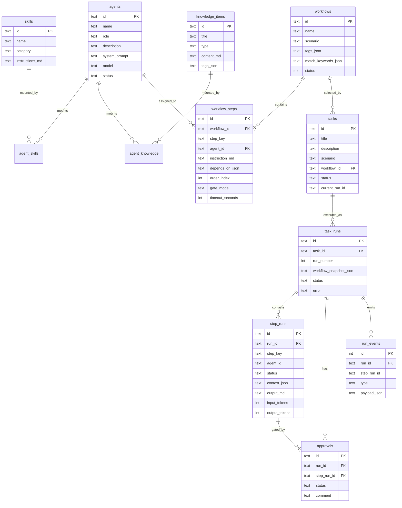
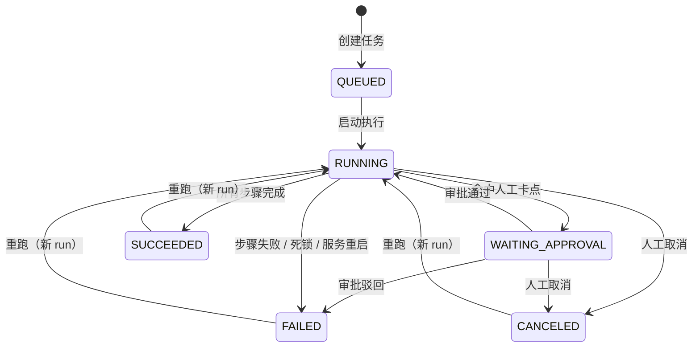
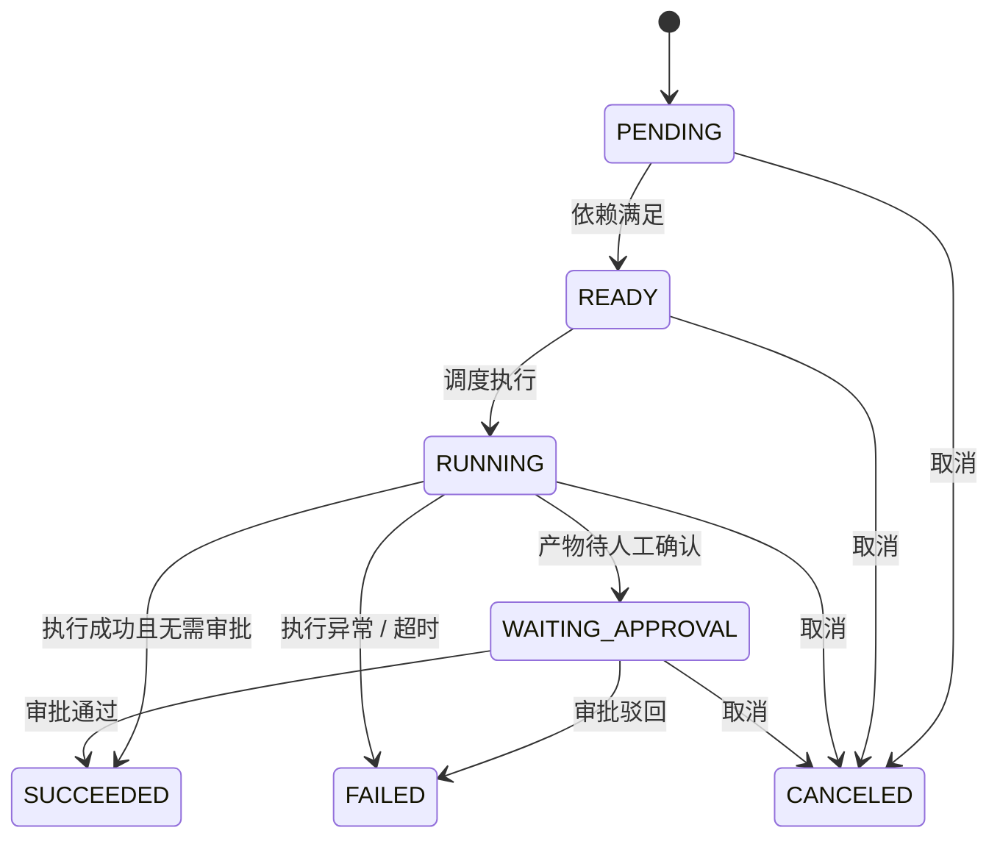

# AutoSDD 详细设计文档

> 版本：v1.0 · 2026-10-30
> 定位：参考阿里 AutoWonder（`alibabacloud-landing-zone/ai-sdlc/auto-wonder`）的最小化 SDLC 系统
> 目标：用一套可运行的全栈应用，讲清「Agent 管理 → Workflow 编排 → 任务执行与观察」这条主链路

---

## 1. 背景与目标

### 1.1 问题

AutoWonder 把「数字员工 + 小队 + 工单 + 派发」做成了一个组织级平台，但它的完整实现依赖 Java / Spring Boot、MySQL、Redis、OSS、本地执行器 daemon、WebSocket 长连接等一整套基础设施，理解成本高、复现成本更高。

本项目的目标不是复刻功能，而是**提炼最小闭环**：一个任务从「选择场景」到「多个角色化 Agent 依次执行」再到「人能看到每一步发生了什么」，需要哪些最小概念与机制。

### 1.2 三个核心目标

1. **Agent 管理**：创建角色化 Agent，给它挂载 Skill（方法/操作指令）与知识（规范/业务/经验），并能预览最终注入模型的上下文。
2. **Workflow 管理**：把任务拆成若干步骤，每一步指定一个 Agent；步骤之间有显式依赖；可在步骤上设置人工审批卡点。
3. **任务管理**：输入任务描述后按场景匹配 Workflow，启动执行，实时观察每一步的状态、流式输出、耗时、Token 与事件；支持人工审批、取消、重跑。

### 1.3 非目标（明确不做）

- 多租户、登录、SSO、RBAC；
- Squad（小队）、跨团队数字人共享；
- Agent 版本评审 / 发布 / 回滚；
- 本地执行器 daemon、WebSocket 调度、OSS 任务包；
- 记忆审核流、向量检索、RAG；
- DAG 拖拽画布、条件分支、并行执行（**数据模型与引擎已兼容，UI 暂不提供**）；
- 成本/配额看板、IM 通知、定时任务；
- Skill/知识文件上传与解析（以 Markdown 文本录入）。

> 本项目是**演示与设计验证系统**，默认只监听 `127.0.0.1`，没有鉴权，不应直接暴露到公网。

---

## 2. 参考产品拆解与取舍

### 2.1 AutoWonder 的关键概念

| 概念 | 含义 |
|---|---|
| Agent / 数字员工 | 角色化 AI worker，有身份、职责、技能、记忆、默认 SDLC |
| Skill | 可复用技能包，执行器据此加载 |
| Memory | 团队经验库，按 AGENT / SQUAD / ORG 作用域挂载，审核后进入任务包 |
| SDLC | 某个 Agent 自己的步骤链 / runbook |
| Workitem | 需求 / Bug / 任务载体，绑定 SDLC 与当前步骤 |
| Dispatch | 「某工单的某一步交给某 Agent 的某执行器」的一次记录 |
| Task Package | 运行前冻结的身份、技能、记忆、SDLC、队友产物快照 |
| Handoff | 当前执行者上报下一棒交给谁 |

AutoWonder 的核心架构事实：**平台只负责派发与调度，步骤怎么走、下一棒交给谁，由本地 Agent 按 runbook 自己决定并上报**。这让流程灵活，但也让平台无法强约束执行边界。

### 2.2 本项目的取舍

| AutoWonder | AutoSDD | 理由 |
|---|---|---|
| Agent（含版本） | `agents`（单版本） | 最小化；版本化留到路线图 |
| Skill / Memory 挂载 | `skills` / `knowledge_items` + 关联表 | 保留「可挂载」这一核心体验 |
| 每 Agent 一条 SDLC | 任务级 `workflows` + `workflow_steps` | 用户要的是「一个任务由哪些 Agent 跑」，流程应属于任务/场景，而非某个 Agent |
| 线性 runbook + Agent 自上报 handoff | 显式 `depends_on` 就绪队列 | 平台强约束下一棒；线性是 DAG 的简单形态 |
| Workitem | `tasks` | 保留标题、描述、场景、状态 |
| Dispatch | `step_runs` | 一次「任务某步交给某 Agent」的完整记录 |
| Executor daemon / WS | `AgentExecutor` 接口（Mock / Anthropic） | 进程内执行，去掉调度基础设施 |
| Task Package | `workflow_snapshot` + 上下文组装 | 运行开始冻结流程、Agent、技能、知识 |
| 小队、多租户、OSS、IM | 不做 | 与最小闭环无关 |

**一句话：AutoWonder 编排「谁来做」，AutoSDD 在最小范围里同时演示「谁来做」和「按什么顺序、拿到什么上下文、做到什么算完成」。**

---

## 3. 总体架构

```
┌────────────────────────────────────────────────────────────┐
│                     Browser (React + Vite)                 │
│  总览 / Agent / Skill / 知识 / Workflow / Task / 运行观察    │
└───────────────┬───────────────────────────┬────────────────┘
                │ REST (JSON)               │ SSE (run events)
┌───────────────▼───────────────────────────▼────────────────┐
│                      Fastify Server                        │
│  HTTP 层：路由 / zod 校验 / 统一 envelope / 错误映射          │
│  ┌──────────────┐  ┌──────────────┐  ┌─────────────────┐   │
│  │ Domain       │  │ Execution    │  │ Overview        │   │
│  │ Agent/Skill  │  │ Context      │  │ 聚合查询         │   │
│  │ Knowledge    │  │ Builder      │  │                 │   │
│  │ Workflow     │  │ Orchestrator │  │                 │   │
│  │ Task         │  │ Executors    │  │                 │   │
│  └──────┬───────┘  └──────┬───────┘  └────────┬────────┘   │
│         └─────────────────┴───────────────────┘            │
│                      SQLite (node:sqlite)                  │
└────────────────────────────────────────────────────────────┘
```

### 3.1 技术栈

| 层 | 选型 | 说明 |
|---|---|---|
| 语言 | TypeScript 5.9 | 前后端共享类型 |
| 后端 | Node 22.13+ + Fastify 5 | 轻量、schema 友好、SSE 易实现 |
| 数据库 | SQLite + 内置 `node:sqlite`（`DatabaseSync`） | 零运维、同步 API、天然适合单进程编排；无需原生编译 |
| 校验 | zod 4 | 请求边界校验，前后端共享 schema |
| 前端 | React 19 + Vite 8 + React Router 7 | 控制台 SPA |
| 数据请求 | TanStack Query 5 | 缓存、失效、轮询兜底 |
| Markdown | react-markdown 10 + remark-gfm | 默认不渲染原始 HTML，规避 XSS |
| 测试 | Vitest 5 + RTL + Playwright 1.64 | 单元 / 集成 / E2E |
| 模型 | Anthropic SDK 1.3（可选） | 默认 Mock，无 Key 可完整演示 |

选择 **SQLite + 手写 SQL** 而非 ORM：本系统表少、查询明确，手写 SQL 可读、可控，事务边界清晰；迁移用简单的顺序 SQL 文件 + `schema_migrations` 表。同步 API 也让编排器状态更新天然串行，避免异步写竞争。

数据库驱动使用 Node 内置的 `node:sqlite`（`DatabaseSync`），并以 `Db` 门面把 `prepare/exec/transaction` 包装成与 better-sqlite3 一致的调用形态。这样无需原生 addon 编译（CI、容器、arm64 都省事），代价是要求 Node ≥ 22.13，且启动时会出现一次 `ExperimentalWarning: SQLite is an experimental feature`，可忽略。若未来需要更强的 SQLite 特性（自定义函数、备份 API），只需替换 `db/database.ts` 的实现，仓储层不变。

### 3.2 运行形态

- 开发：`pnpm dev` 同时启动 server（4000）与 web（5173），Vite 代理 `/api` 与 SSE。
- 生产演示：`pnpm build && pnpm start`，server 托管 `apps/web/dist`，单进程单端口。
- 单工作空间、无登录；SQLite 文件默认 `./data/autosdd.db`。
- 配置全部来自环境变量；`apps/server/.env.example` 列出全部变量，`dev/start/seed` 通过 `tsx --env-file-if-exists=.env` 自动加载 `apps/server/.env`（该文件被 git 忽略）。
- 编排器与 HTTP 服务同进程；进程内 `EventEmitter` + 持久化事件表实现观察与回放。

---

## 4. 领域模型

### 4.1 ER 图



### 4.2 表设计

完整 DDL 见 `apps/server/src/db/migrations/001_init.sql`。约定：主键为 ULID 文本；时间为 ISO-8601 文本；JSON 列以 `_json` 结尾；状态用大写枚举。

#### agents
| 列 | 类型 | 说明 |
|---|---|---|
| id | TEXT PK | ULID |
| name | TEXT | 展示名 |
| role | TEXT | 角色标识，如「需求分析师」 |
| description | TEXT | 一句话职责 |
| system_prompt | TEXT | 身份与行为约束（Markdown） |
| model | TEXT | 模型 ID，默认 `claude-sonnet-5` |
| status | TEXT | ACTIVE / DISABLED |
| created_at / updated_at | TEXT | |

#### skills
| 列 | 说明 |
|---|---|
| id / name / category | 技能标识与分类 |
| description | 一句话说明 |
| instructions_md | 注入模型的操作指令（相当于 SKILL.md 正文） |

#### knowledge_items
| 列 | 说明 |
|---|---|
| id / title / type | type ∈ RULE / BUSINESS / API / LESSON / MEMORY |
| content_md | 知识正文 |
| tags_json | 标签数组，用于检索/展示 |

#### agent_skills / agent_knowledge
`(agent_id, skill_id/knowledge_id)` 联合主键，`sort_order` 控制注入顺序。删除 Agent 级联；删除 Skill/知识级联解除挂载。

#### workflows
| 列 | 说明 |
|---|---|
| id / name / description | |
| scenario | 场景名，如「新功能开发」 |
| tags_json | 场景标签 |
| match_keywords_json | 匹配关键词 |
| status | DRAFT / ENABLED（只有 ENABLED 可被匹配与执行） |

#### workflow_steps
| 列 | 说明 |
|---|---|
| id / workflow_id | |
| step_key | 工作流内唯一、稳定标识（如 `s1`） |
| name | 步骤名 |
| agent_id | 执行该步骤的 Agent |
| instruction_md | 给该 Agent 的本步指令 |
| depends_on_json | 依赖的 step_key 数组；空数组 = 根步骤 |
| order_index | 展示与同批就绪时的排序 |
| gate_mode | NONE / HUMAN_APPROVAL |
| timeout_seconds | 默认 300 |

**线性是 DAG 的特例**：`s1: []`、`s2: ["s1"]`、`s3: ["s2"]`。未来支持分支/并行无需改表；编排器已按依赖就绪集合调度，只是当前 `maxConcurrency = 1`。

#### tasks
| 列 | 说明 |
|---|---|
| id / title / description / scenario | |
| workflow_id | 选中的工作流 |
| status | QUEUED / RUNNING / WAITING_APPROVAL / SUCCEEDED / FAILED / CANCELED |
| current_run_id | 最新一次 run |

#### task_runs
| 列 | 说明 |
|---|---|
| id / task_id / run_number | 同一任务多次重跑，run_number 递增 |
| workflow_snapshot_json | **运行开始时冻结**的流程、Agent、技能、知识快照 |
| status / error | |
| started_at / finished_at | |

#### step_runs
| 列 | 说明 |
|---|---|
| id / run_id / step_key | |
| step_name / agent_id / agent_name_snapshot | 冻结展示信息 |
| instruction_snapshot | 冻结步骤指令 |
| depends_on_json / order_index / gate_mode | 冻结调度信息 |
| status | PENDING / READY / RUNNING / WAITING_APPROVAL / SUCCEEDED / FAILED / CANCELED / SKIPPED |
| attempt | 执行次数（当前最多 1 次） |
| context_json | 实际送给模型的 system/user prompt 与统计 |
| output_md | 步骤产物 |
| error / model / input_tokens / output_tokens | |
| started_at / finished_at | |

#### approvals
| 列 | 说明 |
|---|---|
| id / run_id / step_run_id | |
| status | PENDING / APPROVED / REJECTED |
| comment | 审批意见 |
| requested_at / decided_at | |

#### run_events
| 列 | 说明 |
|---|---|
| id | INTEGER 自增，单调递增，作为 SSE 游标 |
| run_id / step_run_id | |
| type | 见 §6.4 |
| message | 人类可读摘要 |
| payload_json | 结构化数据 |
| created_at | |

### 4.3 状态机

#### Task / Run



#### StepRun



**审批语义**：步骤先执行并产出结果，然后停在 `WAITING_APPROVAL`，人工可阅读产物后决定通过/驳回。通过才把步骤标记成功并放行后继；驳回让 run 失败。审批绑定具体的 `step_run`，旧 run 的审批不会影响新 run。

### 4.4 关键一致性约束

- 同一任务同一时刻最多一个活跃 run（RUNNING / WAITING_APPROVAL）。启动前校验，否则返回 `RUN_IN_PROGRESS`。
- 所有状态迁移使用「带前置状态条件的 UPDATE」，并检查 `changes === 1`，避免重复审批、取消与完成之间的竞态。
- 创建 run 时在同一事务内写入 run、全部 step_runs 与 `RUN_STARTED` 事件，保证不会出现「有 run 无步骤」。
- 审批决策同样在事务内更新 approval + step_run + run/task + 事件。
- `run_events.id` 单调递增，SSE 以 `Last-Event-ID` 回放，天然去重。

---

## 5. 执行引擎

### 5.1 上下文组装

#### System Prompt（身份与约束）

固定顺序，保证可解释、可预览：

```
# 你的身份
角色：{role}
职责：{description}
{system_prompt}

# 你的技能（Skills）
## {skill.name}
{skill.instructions_md}

# 你必须遵守的知识（Knowledge）
## {knowledge.title} · {typeLabel}
{knowledge.content_md}
...

# 输出契约
- 使用 Markdown 输出
- 不要编造未提供的业务事实
- 结论优先，必要时给出依据与风险
```

- Skill 按挂载 `sort_order` 注入；知识同样。
- 知识最多注入 **50 条**（与 AutoWonder 的记忆上限一致），超出按顺序截断并提示。
- 预算：system ≤ 24k 字符；Skills ≤ 8k；Knowledge ≤ 12k。单条超出按片段截断，末尾追加 `…（已截断）`；预览接口返回 `truncated` 与各段字符数。

#### User Prompt（本步任务）

```
# 当前任务
标题：{task.title}
描述：{task.description}
场景：{task.scenario}

# 当前步骤
步骤：{step.name}
{step.instruction_md}

# 上游产物
## {dependency step name}
{dependency output_md | （无）}
...

# 请开始执行
直接输出本步骤的最终产物，不要输出与任务无关的寒暄。
```

- 依赖产物最多 12k 字符，按 `order_index` 顺序拼接。
- 组装结果写入 `step_runs.context_json`，运行详情可查看「这一步到底给模型看了什么」。

### 5.2 Executor 抽象

```ts
export interface AgentExecutor {
  readonly kind: 'mock' | 'anthropic';
  run(
    input: ExecutorInput,
    emit: (event: ExecutorEvent) => void,
    signal: AbortSignal,
  ): Promise<ExecutorResult>;
}
```

- `ExecutorEvent`：`delta`（流式文本）或 `log`（过程日志）。
- `ExecutorResult`：`output`、`model`、`inputTokens`、`outputTokens`。
- 所有执行器共享同一超时、取消与事件语义；上层不关心模型来源。

#### MockExecutor

- 根据 Agent 角色与步骤名选择模板：需求规格、架构设计、实现说明、测试报告、评审结论、文档。
- 输出引用任务标题、上游产物摘要、已挂载技能/知识名称，形成可读的「伪真实」产物。
- 按段落分片流式输出，默认每片延迟 `MOCK_DELAY_MS`（250ms），总时长 2–4 秒。
- 任务描述或步骤指令含 `[fail]`，或设置 `MOCK_FAIL_STEP={步骤名称或任务标题}` 时抛错，便于演示失败与测试。
- Token 估算：`round(chars / 3)`。

#### AnthropicExecutor

- `@anthropic-ai/sdk` 的 `messages.stream`，`system` + 单条 user message。
- 模型取 Agent 的 `model`；`max_tokens = 4096`。
- 逐段 `delta`；结束时读取 `usage.input_tokens/output_tokens`。
- 支持 `AbortSignal`（取消/超时）；错误统一包装为 `LLM_ERROR`，不向客户端泄露 Key 或堆栈。
- Key 只存在于服务端环境变量，前端只看到执行器类型。

#### 工厂

```
LLM_PROVIDER=mock        → Mock
LLM_PROVIDER=anthropic   → Anthropic（缺 Key 启动即报配置错误）
未设置                    → 有 ANTHROPIC_API_KEY 则 Anthropic，否则 Mock
```

### 5.3 编排器

#### 启动 run

```
startRun(taskId):
  1. 校验 task 非活跃、workflow 为 ENABLED、通过 Workflow 校验
  2. 事务：run_number = max+1；冻结 snapshot；写 task_run + N 个 step_run(PENDING) + RUN_STARTED
  3. 更新 task.status=RUNNING, current_run_id
  4. setImmediate(runLoop(runId))
  5. 返回 runId
```

#### runLoop（DAG 就绪队列，当前并发 1）

```
while true:
  run = reload
  if run.status == CANCELED: return
  steps = reload step_runs
  if any step FAILED: failRun; return
  if all steps SUCCEEDED/SKIPPED: succeedRun; return
  if any step WAITING_APPROVAL: set run WAITING_APPROVAL; return   // 等审批回调
  ready = steps where status=PENDING and all deps SUCCEEDED/SKIPPED
  if ready empty: failRun(DEADLOCK); return
  step = ready.sort(order_index)[0]
  executeStep(step)
  if step WAITING_APPROVAL: set run WAITING_APPROVAL; return
  if step FAILED: failRun; return
```

- **线性流程**下任一时刻 ready 恰好 1 个；未来并发 >1 只需去掉「取一个」的限制。
- 死锁（依赖成环或依赖失败却未被标记）会显式失败，而不是永远挂起。
- 同一 run 用 `Set<runId>` 防重入；审批恢复时重新进入 loop。

#### 执行单步

```
executeStep:
  step: PENDING → RUNNING（条件更新）
  emit STEP_STARTED
  context = buildContext(snapshot.agent, step, task, dependency outputs)
  save step.context_json
  result = executor.run(..., emit delta → 实时广播, AbortSignal(超时))
  if gate HUMAN_APPROVAL:
      step → WAITING_APPROVAL；创建 approval(PENDING)；emit APPROVAL_REQUESTED
  else:
      step → SUCCEEDED；emit STEP_SUCCEEDED
  on error:
      step → FAILED, error；emit STEP_FAILED
```

`STEP_DELTA` 只实时广播、不落库（避免高频写放大）；最终 `output_md` 落库。断线重连后从 `step_runs.output_md` 恢复完整文本，事件历史只回放状态变化。

#### 审批

```
approve(stepRunId, decision, comment):
  条件更新 approval PENDING → APPROVED/REJECTED（事务）
  APPROVED: step WAITING_APPROVAL → SUCCEEDED；emit APPROVAL_DECIDED + STEP_SUCCEEDED；resume runLoop
  REJECTED: step → FAILED；run/task → FAILED；emit APPROVAL_DECIDED + RUN_FAILED
  非 PENDING 或 run 已终态 → APPROVAL_NOT_PENDING
```

#### 取消

```
cancel(taskId):
  活跃 run 置 CANCELED；未完成 step 置 CANCELED；pending approval 置 REJECTED?
  → approval 保持 PENDING 但 run 终态，UI 不再展示确认按钮
  AbortController.abort()
  emit RUN_CANCELED
```

#### 重跑

终态任务再次启动：创建新 run（冻结当下 workflow/agent/知识），旧 run 与产物全部保留。`GET /api/tasks/:id/runs` 可对比历史。

#### 进程重启恢复

启动时：

- `task_runs.status = RUNNING` → 标记 FAILED，error=`SERVER_RESTARTED`；其 RUNNING/READY 步骤标记 FAILED；写 `RUN_FAILED` 事件；任务标记 FAILED，UI 提示「执行被服务重启中断，可重跑」。
- `WAITING_APPROVAL` 保留：人工仍可审批，审批通过后编排器从暂停点继续（内存无 loop，但 approve 会重新拉起）。

### 5.4 场景 → Workflow 匹配

纯函数、确定性、可测试：

```
score = 0
if workflow.scenario == input.scenario: score += 10  // 精确场景
for kw in workflow.match_keywords:
    if kw 出现在 (title + description)（中文子串，英文忽略大小写）: score += 3
for tag in workflow.tags:
    if tag 出现在文本: score += 1
只考虑 status=ENABLED
按 score 降序，取前 3；score=0 不返回
```

返回 `{ workflow, score, reasons[] }`，`reasons` 直接展示给用户（如「场景命中：新功能开发」「关键词命中：报表、导出」）。不做 LLM 分类，避免不确定性与额外成本；未来可加 `matchMode=llm`。

---

## 6. API 设计

### 6.1 约定

- Base：`/api`
- 成功：`{ "ok": true, "data": ... }`
- 失败：`{ "ok": false, "error": { "code": "...", "message": "...", "details": ... } }`
- 校验：zod；失败返回 400 + `VALIDATION_ERROR` + issues。
- 错误码：`VALIDATION_ERROR`、`NOT_FOUND`、`CONFLICT`、`WORKFLOW_INVALID`、`NO_WORKFLOW_MATCH`、`RUN_IN_PROGRESS`、`APPROVAL_NOT_PENDING`、`LLM_NOT_CONFIGURED`、`LLM_ERROR`、`INTERNAL`。
- 时间均为 ISO-8601 UTC 字符串。

### 6.2 资源接口

| 方法 | 路径 | 说明 |
|---|---|---|
| GET | `/api/agents?q=` | 列表（含 skillCount / knowledgeCount） |
| POST | `/api/agents` | 创建 |
| GET | `/api/agents/:id` | 详情（含 skills / knowledge） |
| PUT | `/api/agents/:id` | 更新基本信息 |
| DELETE | `/api/agents/:id` | 被 Workflow 引用时 409 |
| PUT | `/api/agents/:id/mounts` | `{ skillIds, knowledgeIds }` 整体替换挂载 |
| GET | `/api/agents/:id/context-preview?stepName=` | 返回组装后的 systemPrompt / userPrompt / 统计 |
| GET | `/api/skills?q=` | 技能列表 |
| POST/PUT/DELETE | `/api/skills[/:id]` | 技能 CRUD；删除级联解除挂载 |
| GET | `/api/knowledge?q=&type=` | 知识列表 |
| POST/PUT/DELETE | `/api/knowledge[/:id]` | 知识 CRUD |
| GET | `/api/workflows?status=` | 工作流列表（含步骤数、Agent 名） |
| POST | `/api/workflows` | 创建工作流（含步骤） |
| GET | `/api/workflows/:id` | 详情（含步骤） |
| PUT | `/api/workflows/:id` | 整体替换（事务） |
| DELETE | `/api/workflows/:id` | 被任务引用时 409 |
| POST | `/api/workflows/:id/validate` | 返回 `{valid, errors[]}` |
| POST | `/api/workflows/match` | `{ text, scenario? }` → 推荐列表 |
| GET | `/api/tasks?status=&q=` | 任务列表 |
| POST | `/api/tasks` | `{ title, description, scenario?, workflowId? }`；未指定则自动匹配，无匹配 400 |
| GET | `/api/tasks/:id` | 任务 + 当前 run + 步骤 + 审批 + 工作流 |
| POST | `/api/tasks/:id/run` | 启动/重跑，返回 `{ runId }` |
| POST | `/api/tasks/:id/cancel` | 取消活跃 run |
| GET | `/api/tasks/:id/runs` | 历史 run 列表 |
| GET | `/api/runs/:runId` | run + 步骤 + 审批 |
| GET | `/api/runs/:runId/events?after=` | 事件历史 |
| GET | `/api/runs/:runId/stream` | SSE；支持 `Last-Event-ID` |
| POST | `/api/runs/:runId/steps/:stepRunId/approval` | `{ decision: APPROVED\|REJECTED, comment? }` |
| GET | `/api/overview` | 计数、成功率、最近任务、执行器类型 |

### 6.3 关键请求示例

创建 Workflow：

```json
{
  "name": "新功能开发",
  "description": "从需求到评审的标准交付链路",
  "scenario": "新功能开发",
  "tags": ["需求", "开发", "评审"],
  "matchKeywords": ["新功能", "新增", "报表", "导出"],
  "status": "ENABLED",
  "steps": [
    {
      "stepKey": "s1",
      "name": "需求分析",
      "agentId": "01J...",
      "instructionMd": "输出需求规格、用户故事与验收标准",
      "dependsOn": [],
      "gateMode": "NONE",
      "timeoutSeconds": 300
    },
    {
      "stepKey": "s2",
      "name": "架构设计",
      "agentId": "01J...",
      "instructionMd": "给出模块划分、接口契约与数据模型",
      "dependsOn": ["s1"],
      "gateMode": "NONE"
    }
  ]
}
```

创建任务（自动匹配）：

```json
{ "title": "新增销售报表导出", "description": "支持按日期导出 CSV，包含权限校验", "scenario": "新功能开发" }
```

响应：

```json
{
  "ok": true,
  "data": {
    "id": "01J...",
    "workflowId": "01J...",
    "workflowName": "新功能开发",
    "status": "QUEUED"
  }
}
```

### 6.4 SSE 事件

```
id: 42
event: run
data: {"id":42,"runId":"01J...","stepRunId":"01J...","type":"STEP_STARTED","message":"架构设计 开始执行","payload":{"stepKey":"s2"},"createdAt":"2026-10-30T..."}
```

事件类型：

| type | 含义 |
|---|---|
| RUN_STARTED | run 创建并开始 |
| STEP_READY | 步骤依赖满足，进入就绪 |
| STEP_STARTED | 步骤开始执行 |
| STEP_DELTA | 流式文本（**仅实时，不落库**） |
| STEP_OUTPUT | 最终产物已保存（payload 含字符数） |
| APPROVAL_REQUESTED | 命中人工卡点 |
| APPROVAL_DECIDED | 审批结果 |
| STEP_SUCCEEDED / STEP_FAILED | 步骤终态 |
| RUN_SUCCEEDED / RUN_FAILED / RUN_CANCELED | run 终态 |
| LOG | 过程日志 |

SSE 连接流程：先订阅内存事件 → 回放 `Last-Event-ID` 之后的数据库事件 → 按 id 去重推送 → 进入实时；每 15 秒发送心跳注释 `: ping`。

---

## 7. 前端设计

### 7.1 信息架构

```
┌──────────────────────────────────────────────────────────────┐
│ Logo  AutoSDD          执行器: Mock/Anthropic   [+ 新建任务]  │ 56px
├────────────┬─────────────────────────────────────────────────┤
│ 工作台      │                                                 │
│  总览       │                                                 │
│  任务       │                 页面内容                         │
│ 资产        │                                                 │
│  智能体     │                                                 │
│  技能       │                                                 │
│  知识       │                                                 │
│ 编排        │                                                 │
│  工作流     │                                                 │
│            │                                                 │
│ (底部)版本  │                                                 │
└────────────┴─────────────────────────────────────────────────┘
```

### 7.2 视觉语言

复用 `sdd-orchestrator-prototype.html` 的设计令牌，保持同一套「编辑型控制台」气质：

| Token | 值 | 用途 |
|---|---|---|
| `--paper` | `#fafaf8` | 背景 |
| `--ink` | `#0a0a0a` | 主文字 |
| `--grey-1/2/3` | `#f0f0ee` / `#e0e0de` / `#737373` | 填充 / 分隔线 / 次要文字 |
| `--accent` | `#002FA7` | 主操作、选中、链接 |
| `--skill` | `#0f7b6c` | Skill 语义色 |
| `--know` | `#b45309` | 知识语义色 |
| `--approval` | `#7e22ce` | 人工审批语义色 |
| `--success` / `--danger` / `--warning` | 绿 / 红 / 琥珀 | 状态 |
| 字体 | Inter / PingFang SC + JetBrains Mono | 正文 13px，元信息 10–11px |
| 圆角/阴影 | 10px / 双层轻阴影 | 卡片、弹层 |

使用原生 CSS + CSS 变量，不引入 UI 组件库；组件保持小而聚焦，CSS 按组件/页面拆分。

### 7.3 页面线框

#### 总览

```
┌ 总览 ────────────────────────────────────────────────┐
│ 6 个 KPI：智能体 / 技能 / 知识 / 工作流 / 进行中 / 成功率 │
├──────────────────────────────┬───────────────────────┤
│ 最近任务（表格）              │ 执行器与提示           │
│ 状态 标题 工作流 当前步骤 时间 │ Mock（离线可演示）      │
│                              │ 配置 ANTHROPIC_API_KEY │
└──────────────────────────────┴───────────────────────┘
```

#### Agent 详情

```
┌ ← 智能体 / 需求分析师 ────────────────────────────────┐
│ [配置] [技能与知识] [上下文预览]                       │
├───────────────────────────┬───────────────────────────┤
│ 名称 / 角色 / 模型 / 状态  │ 挂载的 Skills（勾选）      │
│ 职责描述                   │ 挂载的知识（勾选）         │
│ System Prompt (Markdown)   │ 保存挂载                   │
└───────────────────────────┴───────────────────────────┘

上下文预览：左 System Prompt ｜ 右 User Prompt（示例步骤）
底部：字符数、知识条数、是否截断
```

#### Workflow 编辑器

```
┌ 新功能开发  [草稿/启用]                     [保存] ─┐
│ 场景 / 关键词 / 描述                                │
├──────────┬──────────────────────┬───────────────────┤
│ 步骤列表  │ 管线预览（纵向）       │ 步骤检查器         │
│ 01 需求   │ ┌ 需求分析 ┐          │ 名称 / Agent       │
│ 02 架构   │ │ 需求分析师│          │ 指令 (Markdown)    │
│ 03 编码⚑  │ └────┬────┘          │ 人工卡点开关        │
│ + 添加    │ ┌ 架构设计 ┐          │ 超时               │
│          │ │ 架构师    │          │ 依赖（只读：上一步）│
│          │ └────┬────┘          │                   │
└──────────┴──────────────────────┴───────────────────┘
```

#### 任务详情（观察页）

```
┌ ← 任务 / 新增销售报表导出    [RUNNING] [取消] ───────┐
│ 工作流：新功能开发 · 场景：新功能开发 · 开始于 10:21    │
│ ①需求分析 ✓ → ②架构设计 ✓ → ③编码实现 ⚑待审批 → ...  │
├──────────────────┬───────────────────────────────────┤
│ 步骤时间线        │ [输出] [上下文] [事件] [元数据]     │
│ ✓ 需求分析 12s    │                                   │
│ ✓ 架构设计 18s    │  （Markdown 产物 / 流式光标）      │
│ ⚑ 编码实现 8s     │                                   │
│ ○ 质量验证        │ ┌ 审批横幅 ──────────────────────┐ │
│ ○ 代码评审        │ │ 请确认「编码实现」的产物         │ │
│                  │ │ [意见] [驳回] [通过]            │ │
│                  │ └───────────────────────────────┘ │
└──────────────────┴───────────────────────────────────┘
```

### 7.4 前端状态与实时

- React Query 管理服务端状态；列表/详情各自 queryKey。
- 任务详情订阅 `/api/runs/:runId/stream`；收到事件后：
  - 状态类事件 → `invalidateQueries(['task', id])`（合并刷新）；
  - `STEP_DELTA` → 追加到本地流式缓冲（按 stepKey）；
  - `STEP_OUTPUT` → 用最终产物替换流式缓冲。
- SSE 断线由浏览器 EventSource 自动重连；服务端按 `Last-Event-ID` 回放，避免丢状态。
- 组件卸载时关闭 EventSource；React StrictMode 下副作用正确清理。

---

## 8. 安全与边界

| 风险 | 措施 |
|---|---|
| 未授权访问 | 默认绑定 `127.0.0.1`；文档明确「无鉴权，勿公网暴露」 |
| API Key 泄露 | 仅服务端环境变量；错误信息脱敏；前端只显示执行器类型 |
| Markdown XSS | `react-markdown` 默认不渲染 HTML；不启用 `rehype-raw` |
| Prompt 注入 | 任务/知识文本以明确分隔段注入；声明为数据而非指令；不构成安全边界，文档说明 |
| 请求体过大 | Fastify `bodyLimit = 1MB`；各文本字段长度上限（zod） |
| 超时/挂死 | 每步 `AbortSignal` 超时（默认 300s，可配置）；死锁检测 |
| 并发写竞争 | `node:sqlite` 同步 + 单进程；条件 UPDATE + 事务 |
| 重跑污染 | 每次 run 冻结 snapshot；旧 run 只读 |
| 日志泄露 | 不记录完整 prompt 到控制台日志；context 仅存 DB 供本地查看 |

---

## 9. 测试策略

| 层级 | 工具 | 覆盖 |
|---|---|---|
| 单元 | Vitest | matcher 打分/原因、context-builder 顺序与截断、workflow validator（环/缺依赖/Agent 禁用）、状态迁移辅助 |
| 集成 | Vitest + `app.inject` | Agent/Skill/Knowledge CRUD 与挂载、Workflow CRUD/校验、任务全生命周期（mock）：成功、审批通过、审批驳回、失败、取消、重跑、409 冲突 |
| 组件 | Vitest + RTL | StatusBadge、步骤管线、匹配推荐、审批横幅、上下文预览 |
| E2E | Playwright | 创建任务 → 自动匹配 → 运行 → 两次审批 → 成功；断言实时状态与产物 |

- 测试库使用 `:memory:`，每个测试独立 app 实例；Mock 延迟设为 0。
- 服务端覆盖率门禁（`@vitest/coverage-v8`）：lines 75 / functions 75 / branches 70 / statements 75。
- E2E 使用独立数据库 `apps/server/data/e2e.db`（端口 4100，启动前清理），`MOCK_DELAY_MS=5` 控制时长；要求先 `pnpm build`，server 直接托管 `apps/web/dist`。

**当前实测（2026-10-31）**

| 指标 | 结果 |
|---|---|
| 服务端测试 | 87 个测试 / 12 个文件全部通过 |
| 服务端覆盖率 | statements 85.96%、branches 71.12%、functions 90.74%、lines 88.65% |
| 前端组件测试 | 12 个测试全部通过 |
| E2E | 1 条任务全生命周期（两次审批）通过 |

---

## 10. 工程结构

```
autosdd/
├── package.json                 # workspace 脚本
├── pnpm-workspace.yaml
├── tsconfig.base.json
├── docs/DESIGN.md               # 本文档
├── README.md
├── packages/shared/
│   └── src/{index,types,schemas,constants}.ts
├── apps/server/
│   ├── src/
│   │   ├── index.ts             # 监听入口
│   │   ├── app.ts               # buildApp（可测试）
│   │   ├── config.ts
│   │   ├── db/{database,migrate,seed}.ts + migrations/001_init.sql
│   │   ├── http/{errors,respond,validate}.ts
│   │   ├── domain/agents/…      # repository / service / routes / schemas
│   │   ├── domain/skills/…
│   │   ├── domain/knowledge/…
│   │   ├── domain/workflows/…   # + matcher / validator
│   │   ├── domain/tasks/…
│   │   ├── execution/{types,context-builder,run-events,orchestrator,recovery}.ts
│   │   ├── execution/executors/{mock,anthropic,factory}.ts
│   │   └── overview/routes.ts
│   └── test/*.test.ts
├── apps/web/
│   ├── index.html / vite.config.ts
│   └── src/
│       ├── main.tsx / App.tsx / router.tsx
│       ├── api/{client,hooks,sse}.ts
│       ├── styles/{tokens,global}.css
│       ├── components/*.tsx + *.css
│       └── pages/{Overview,Agents,AgentDetail,Skills,Knowledge,Workflows,WorkflowEditor,Tasks,TaskDetail}
└── e2e/{playwright.config.ts,tests/smoke.spec.ts}
```

---

## 11. 演示脚本（种子数据）

1. **资产**：6 个 Agent（需求分析师、系统架构师、开发工程师、测试工程师、代码评审员、技术写作者）、8 个 Skill、8 条知识。
2. **流程**：
   - 新功能开发：需求分析 → 架构设计 → 编码实现（人工卡点）→ 质量验证 → 代码评审（人工卡点）；
   - Bug 修复：问题定位 → 修复实现 → 回归验证；
   - 代码评审：静态评审 → 评审结论。
3. **任务**：一个已完成的历史任务（含 5 步产物），一个待运行任务。
4. **演示路径**：总览 → 查看历史任务产物 → 新建任务（自动推荐「新功能开发」）→ 运行 → 观察流式输出 → 审批通过 → 成功；回到总览看数字变化。

---

## 12. 已知限制与后续路线

| 限制 | 后续 |
|---|---|
| 单进程、单工作空间 | 多租户 + RBAC + Postgres |
| 线性 UI，引擎已支持 DAG | DAG 画布、分支条件、并行调度、汇聚 |
| 进程重启中断运行 | run 级 checkpoint，从最后完成步骤恢复 |
| 无重试预算 | step.attempt + retry budget + 退避 |
| 知识全量注入 | 检索（BM25）+ 渐进式加载（L0–L2） |
| 无 Agent 版本 | 版本快照、评审、发布、回滚、差异对比 |
| 无成本看板 | Token/费用聚合、预算与告警 |
| 无本地执行器 | Claude Code / CLI executor、WebSocket 调度、任务包 |
| 无 IM/通知 | 审批提醒、站内信 |
| 无 Skill 文件上传 | SKILL.md zip 解析与版本管理 |

---

## 13. 验证清单

- [x] `pnpm typecheck` 通过
- [x] `pnpm test` 通过（server 87 + web 12）；覆盖率高于门禁
- [x] `pnpm build` 成功；`pnpm start` 单端口可访问（E2E 即以此形态运行）
- [x] 创建 Agent 并挂载技能/知识，上下文预览顺序正确（集成测试覆盖）
- [x] 创建含人工卡点的 Workflow，校验错误可见（集成测试覆盖）
- [x] 任务自动匹配 Workflow；运行后 SSE 实时更新（集成 + E2E 覆盖）
- [x] 审批通过继续、驳回失败、取消、重跑、服务重启恢复符合预期（集成测试覆盖）
- [x] E2E 冒烟通过
