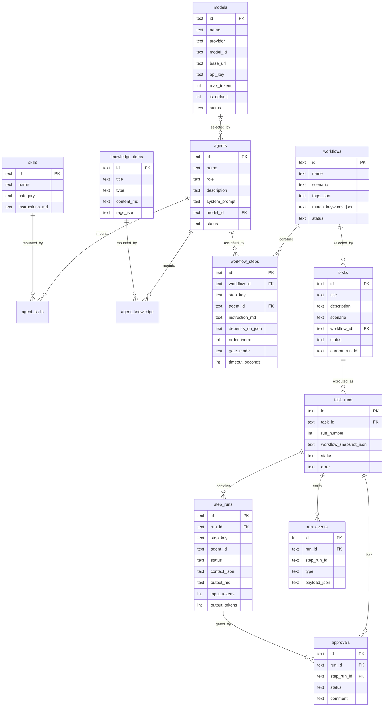
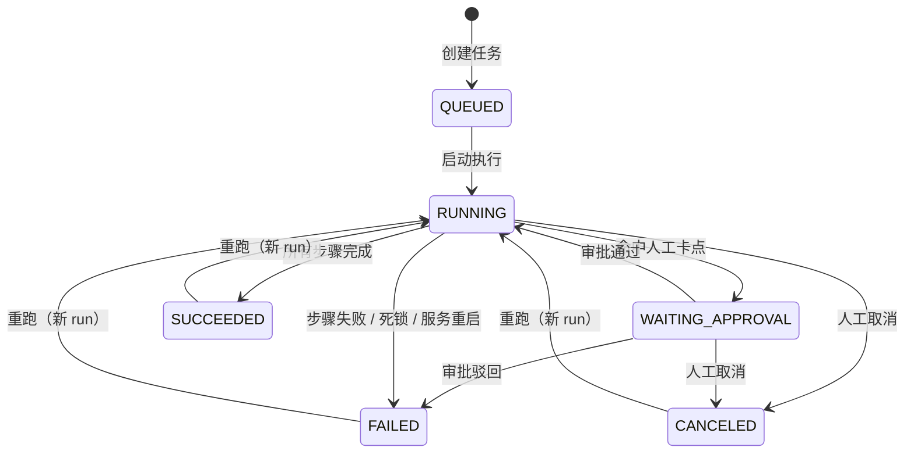
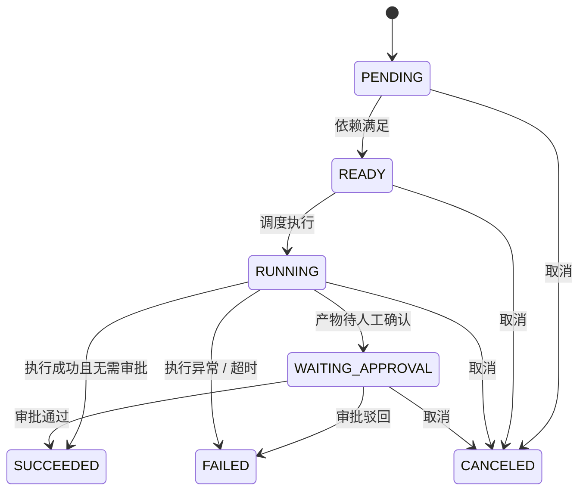

# 领域模型与状态机

> 所属：[AutoSDD 设计文档](README.md)
> 相关：[执行引擎](04-execution.md) · [API 设计](05-api.md) · [迁移目录](../../apps/server/src/db/migrations)

---

## 领域模型

### ER 图

### 表设计

完整 DDL 见 `apps/server/src/db/migrations/`（`001_init.sql`、`002_models.sql`）。约定：主键为 ULID 文本（内置模型除外）；时间为 ISO-8601 文本；JSON 列以 `_json` 结尾；状态用大写枚举。

#### agents
| 列 | 类型 | 说明 |
|---|---|---|
| id | TEXT PK | ULID |
| name | TEXT | 展示名 |
| role | TEXT | 角色标识，如「需求分析师」 |
| description | TEXT | 一句话职责 |
| system_prompt | TEXT | 身份与行为约束（Markdown） |
| model_id | TEXT FK | 绑定的模型；为空时执行期回退默认模型 |
| status | TEXT | ACTIVE / DISABLED |
| created_at / updated_at | TEXT | |

#### models
| 列 | 说明 |
|---|---|
| id | `mdl_*`；内置 `mdl_mock_default`、`mdl_claude_sonnet` |
| name / provider | provider ∈ mock / anthropic / openai |
| model_id | 传给提供方的模型名，如 `qwen-plus` |
| base_url | OpenAI 兼容端点必填；Anthropic 可填代理；Mock 忽略 |
| api_key | 仅服务端读取；公开接口只返回来源（stored / env / none） |
| max_tokens | 1–65536，默认 4096 |
| is_default | 全表至多一条为 1（部分唯一索引 `ux_models_default`） |
| status | ACTIVE / DISABLED |

不变量：默认模型不可删除、不可停用；被 Agent 引用的模型不可删除、不可停用；切换默认在事务内完成（先清空再置 1）。`agents.model_id` 是外键，数据库层同样阻止删除仍被引用的模型。

#### skills
| 列 | 说明 |
|---|---|
| id / name / category | 技能标识与分类 |
| description | 一句话说明 |
| instructions_md | 注入模型的操作指令（相当于 SKILL.md 正文） |

#### knowledge_items
| 列 | 说明 |
|---|---|
| id / title / type | type ∈ RULE / BUSINESS / API / LESSON / MEMORY |
| content_md | 知识正文 |
| tags_json | 标签数组，用于检索/展示 |

#### agent_skills / agent_knowledge
`(agent_id, skill_id/knowledge_id)` 联合主键，`sort_order` 控制注入顺序。删除 Agent 级联；删除 Skill/知识级联解除挂载。

#### workflows
| 列 | 说明 |
|---|---|
| id / name / description | |
| scenario | 场景名，如「新功能开发」 |
| tags_json | 场景标签 |
| match_keywords_json | 匹配关键词 |
| status | DRAFT / ENABLED（只有 ENABLED 可被匹配与执行） |

#### workflow_steps
| 列 | 说明 |
|---|---|
| id / workflow_id | |
| step_key | 工作流内唯一、稳定标识（如 `s1`） |
| name | 步骤名 |
| agent_id | 执行该步骤的 Agent |
| instruction_md | 给该 Agent 的本步指令 |
| depends_on_json | 依赖的 step_key 数组；空数组 = 根步骤 |
| order_index | 展示与同批就绪时的排序 |
| gate_mode | NONE / HUMAN_APPROVAL |
| timeout_seconds | 默认 300 |

**线性是 DAG 的特例**：`s1: []`、`s2: ["s1"]`、`s3: ["s2"]`。未来支持分支/并行无需改表；编排器已按依赖就绪集合调度，只是当前 `maxConcurrency = 1`。

#### tasks
| 列 | 说明 |
|---|---|
| id / title / description / scenario | |
| workflow_id | 选中的工作流 |
| status | QUEUED / RUNNING / WAITING_APPROVAL / SUCCEEDED / FAILED / CANCELED |
| current_run_id | 最新一次 run |

#### task_runs
| 列 | 说明 |
|---|---|
| id / task_id / run_number | 同一任务多次重跑，run_number 递增 |
| workflow_snapshot_json | **运行开始时冻结**的流程、Agent、技能、知识快照 |
| status / error | |
| started_at / finished_at | |

#### step_runs
| 列 | 说明 |
|---|---|
| id / run_id / step_key | |
| step_name / agent_id / agent_name_snapshot | 冻结展示信息 |
| instruction_snapshot | 冻结步骤指令 |
| depends_on_json / order_index / gate_mode | 冻结调度信息 |
| status | PENDING / READY / RUNNING / WAITING_APPROVAL / SUCCEEDED / FAILED / CANCELED / SKIPPED |
| attempt | 执行次数（当前最多 1 次） |
| context_json | 实际送给模型的 system/user prompt 与统计 |
| output_md | 步骤产物 |
| error / model / input_tokens / output_tokens | |
| started_at / finished_at | |

#### approvals
| 列 | 说明 |
|---|---|
| id / run_id / step_run_id | |
| status | PENDING / APPROVED / REJECTED |
| comment | 审批意见 |
| requested_at / decided_at | |

#### run_events
| 列 | 说明 |
|---|---|
| id | INTEGER 自增，单调递增，作为 SSE 游标 |
| run_id / step_run_id | |
| type | 见 [API 与事件协议](05-api.md#sse-事件) |
| message | 人类可读摘要 |
| payload_json | 结构化数据 |
| created_at | |

### 状态机

#### Task / Run

#### StepRun

**审批语义**：步骤先执行并产出结果，然后停在 `WAITING_APPROVAL`，人工可阅读产物后决定通过/驳回。通过才把步骤标记成功并放行后继；驳回让 run 失败。审批绑定具体的 `step_run`，旧 run 的审批不会影响新 run。

### 关键一致性约束

- 同一任务同一时刻最多一个活跃 run（RUNNING / WAITING_APPROVAL）。启动前校验，否则返回 `RUN_IN_PROGRESS`。
- 所有状态迁移使用「带前置状态条件的 UPDATE」，并检查 `changes === 1`，避免重复审批、取消与完成之间的竞态。
- 创建 run 时在同一事务内写入 run、全部 step_runs 与 `RUN_STARTED` 事件，保证不会出现「有 run 无步骤」。
- 审批决策同样在事务内更新 approval + step_run + run/task + 事件。
- `run_events.id` 单调递增，SSE 以 `Last-Event-ID` 回放，天然去重。

