# AutoSDD 使用指南

> 适用版本：v1.0（2026-10-31）
> 设计细节见 [设计文档](../design/README.md)，功能状态见 [功能清单](../FEATURES.md)。
> 本文截图由 `e2e/scripts/screenshots.mjs` 在独立演示库上自动生成，不包含任何真实 API Key。

---

## 1. 快速开始

要求 **Node ≥ 22.13**（使用内置 `node:sqlite`）与 **pnpm 11**。

```bash
pnpm install

# 开发模式：server(4000) + web(5173，Vite 代理 /api 与 SSE)
pnpm dev
# 打开 http://127.0.0.1:5173
```

生产形态（单端口托管前端构建产物）：

```bash
pnpm build
pnpm start        # http://127.0.0.1:4000
```

首次启动会自动建表并写入演示数据：7 个 Agent、9 个 Skill、8 条知识、4 个工作流、2 个内置模型、1 个已完成任务 + 2 个待运行任务。

```bash
pnpm seed                                        # 空库时写入，已有数据则跳过
pnpm --filter @autosdd/server seed -- --force    # 清空并重建演示数据
```

### 配置

所有变量可选，复制 `apps/server/.env.example` 为 `apps/server/.env` 即可被 `dev/start` 自动加载：

| 变量 | 默认 | 说明 |
|---|---|---|
| `HOST` | `127.0.0.1` | 仅本机访问 |
| `PORT` | `4000` | 服务端口 |
| `DATABASE_PATH` | `./data/autosdd.db` | SQLite 文件（相对 `apps/server`） |
| `ANTHROPIC_API_KEY` | — | 未在界面保存 Key 时的兜底，仅服务端使用 |
| `OPENAI_API_KEY` | — | OpenAI 兼容模型的兜底 Key，仅服务端使用 |
| `MOCK_DELAY_MS` | `250` | Mock 每片输出的延迟 |
| `MOCK_FAIL_STEP` | — | 步骤名或任务标题命中即失败，演示失败态 |
| `STEP_TIMEOUT_SECONDS` | `300` | 单步超时 |

---

## 2. 界面总览

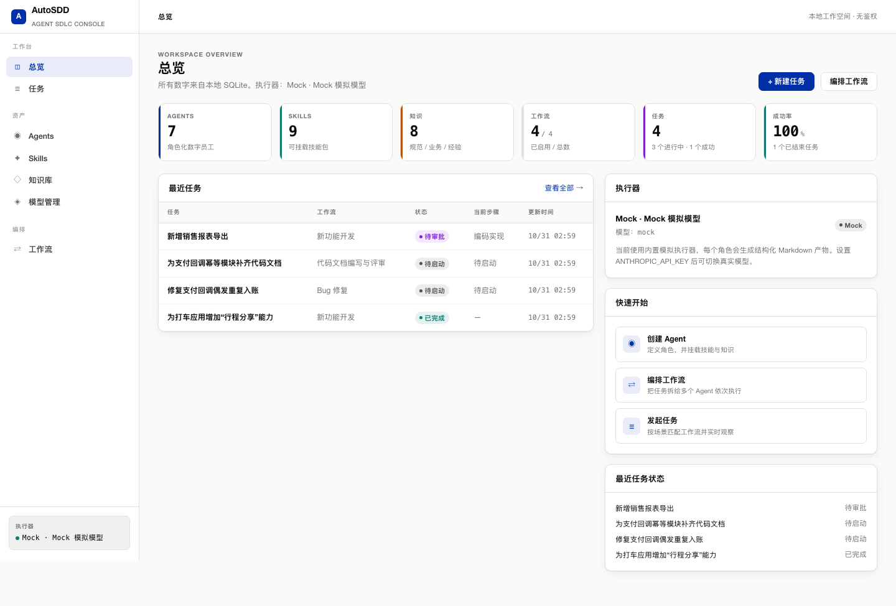

左侧导航分为三组：

- **工作台**：总览、任务；
- **资产**：Agents、Skills、知识库、模型管理；
- **编排**：工作流。

总览展示 Agent / Skill / 知识 / 工作流数量、进行中任务与成功率，右侧可以看到当前执行器与最近任务状态。所有数据来自本地 SQLite。

---

## 3. 模型管理

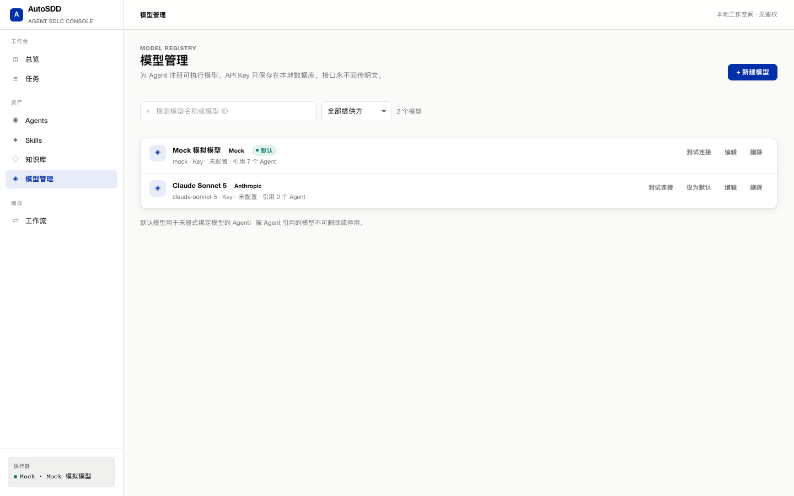

模型是一等资产，每个 Agent 显式选择模型；步骤执行时按 Agent 的 `modelId` 解析执行器，未绑定则跟随默认模型。

- **提供方**：`mock`（默认，无需 Key，可完整演示）、`anthropic`、`openai`（Chat Completions 兼容，覆盖 DeepSeek / 通义千问 / Ollama 等）。
- **Base URL**：OpenAI 兼容模型必填；Anthropic 可留空（官方地址）或填写代理；Mock 忽略。
- **API Key**：仅保存时提交，列表只显示来源（已保存 / 环境变量 / 未配置），接口**永不回传明文**。编辑时留空保持原 Key，填写新值覆盖。
- **Max Tokens**：默认 4096；推理类模型建议调大（如 16384），否则推理过程可能耗尽额度、没有正文输出。
- **测试连接**：对已保存模型真实调用一次；Mock 直接返回成功。
- **默认模型**：全表唯一，不可删除或停用；被 Agent 引用的模型也不可删除或停用。

> 没有可用真实 Key 时，保持 Mock 默认模型即可体验全部流程。

---

## 4. Agent 管理

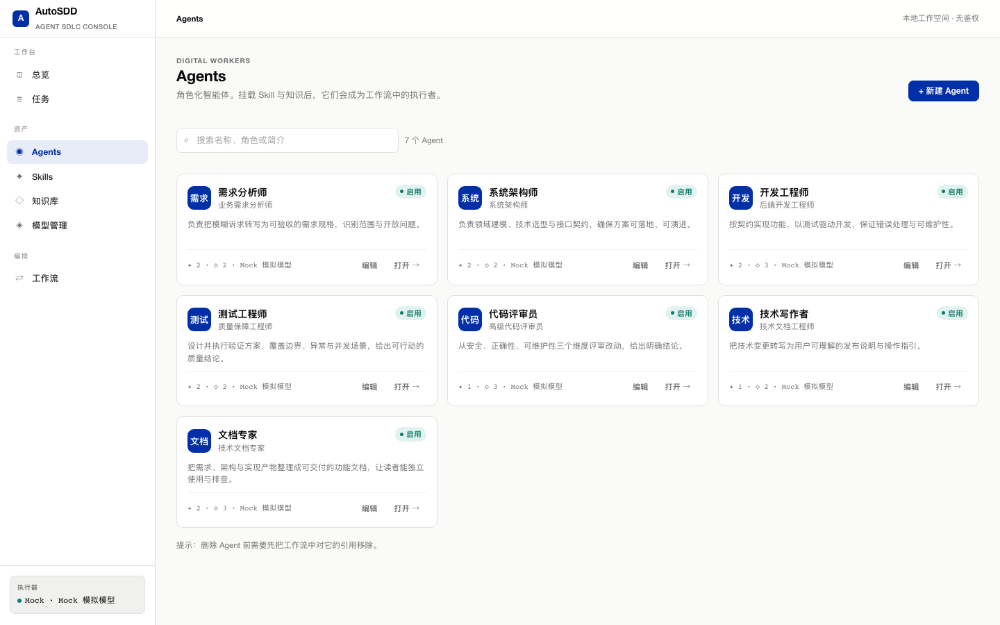

Agent 由名称、角色、简介、系统提示词、模型与状态组成。卡片显示挂载的 Skill / 知识数量与当前模型。

### 4.1 编辑 Agent

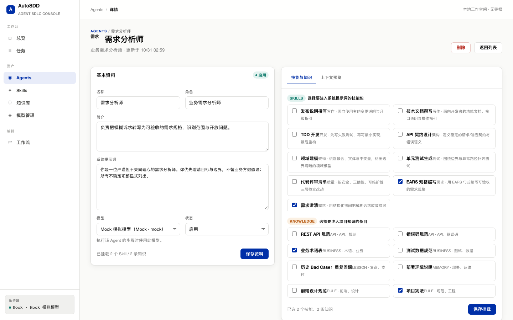

详情页左侧编辑基本资料；右侧在「技能与知识」中勾选挂载项并保存。挂载顺序决定上下文注入顺序。

### 4.2 上下文预览

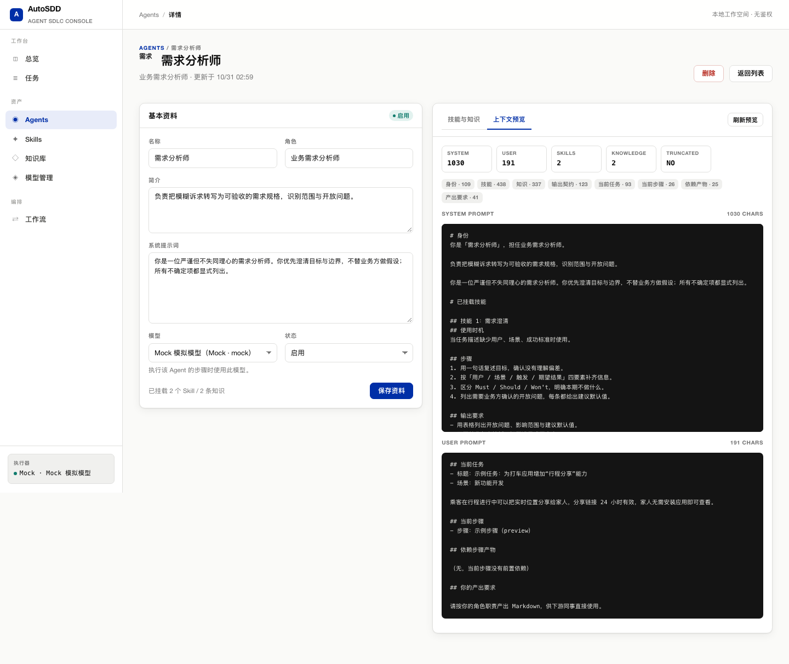

「上下文预览」展示一次示例执行实际会送给模型的 System Prompt 与 User Prompt，并给出：

- 总字符数、Skill 数量、知识条数；
- 各段字符数（身份、技能、知识、输出契约、任务、步骤、依赖产物）；
- 是否发生截断（`TRUNCATED`）。

预览使用固定示例任务且没有依赖产物；它用于检查身份与资产注入，不代表某次真实 run 的 User Prompt。

---

## 5. Skills 与知识库

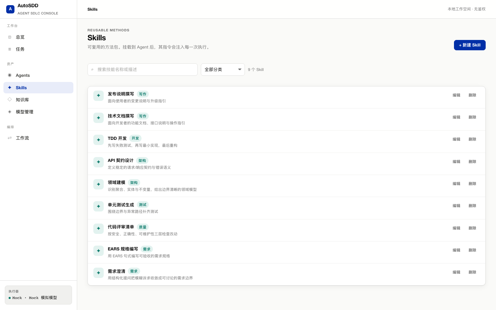

Skill 是可复用的方法/操作指令（相当于 SKILL.md 正文），可按分类维护。

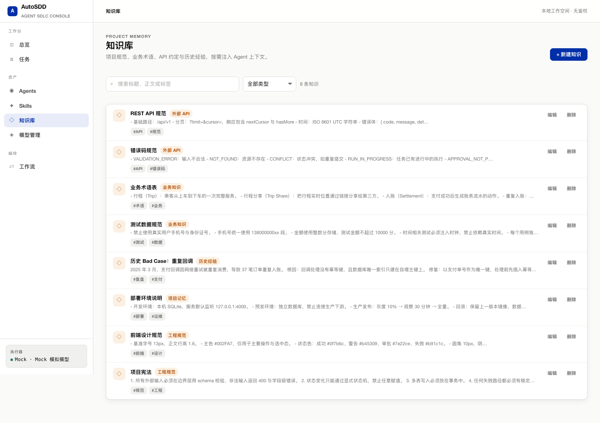

知识用于存放规范、业务术语、API 约定与经验教训，类型包括 RULE / BUSINESS / API / LESSON / MEMORY。知识最多注入 50 条，并按 12k 字符预算截断；详见 [上下文管理设计](../design/10-context.md)。

---

## 6. 工作流

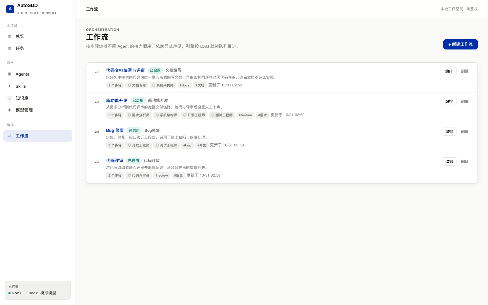

工作流把任务拆成有序步骤，每个步骤指定一个 Agent，并通过 `depends_on` 声明依赖。列表展示步骤数、参与 Agent、场景与启用状态。

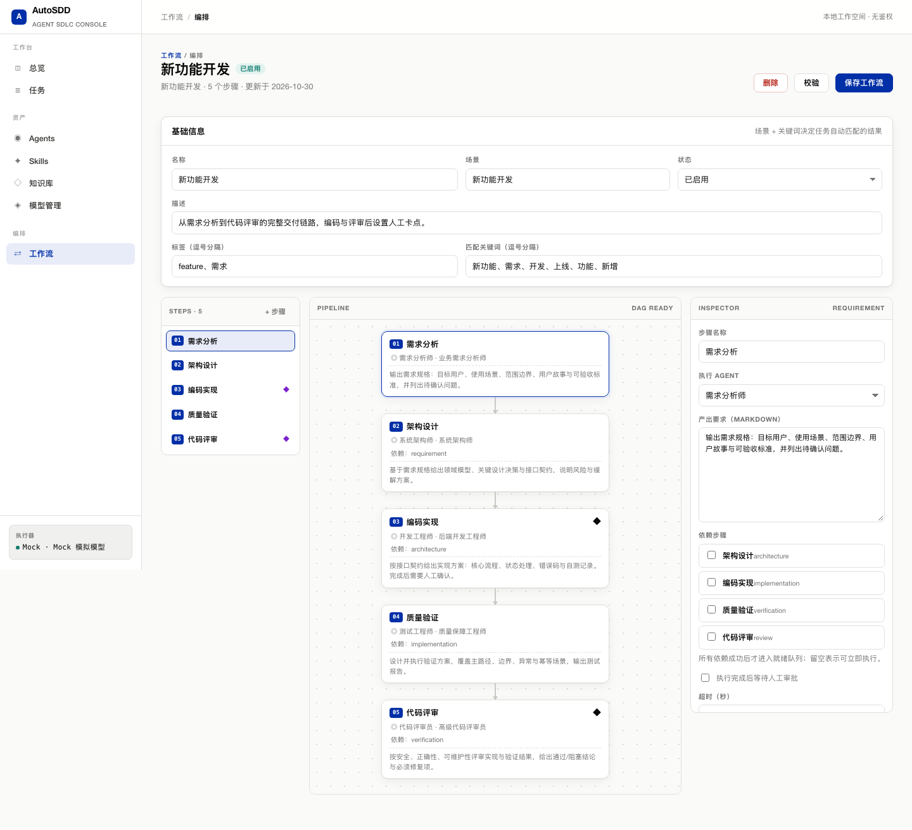

编辑器支持：

- 基本信息：名称、描述、场景、标签、匹配关键词、启用状态；
- 步骤：名称、Agent、指令、人工审批卡点、超时；
- 依赖：当前 UI 按线性链维护，数据模型与引擎已支持 DAG；
- 保存前校验：步骤为空、依赖缺失或成环、引用了停用 Agent 都会报错。

内置工作流：

| 工作流 | 步骤 | 人工卡点 |
|---|---|---|
| 新功能开发 | 需求分析 → 架构设计 → 编码实现 → 质量验证 → 代码评审 | 编码实现、代码评审 |
| Bug 修复 | 问题定位 → 修复实现 → 回归验证 | — |
| 代码评审 | 静态评审 → 评审结论 | — |
| 代码文档编写与评审 | 文档编写 → 文档评审 | — |

---

## 7. 任务

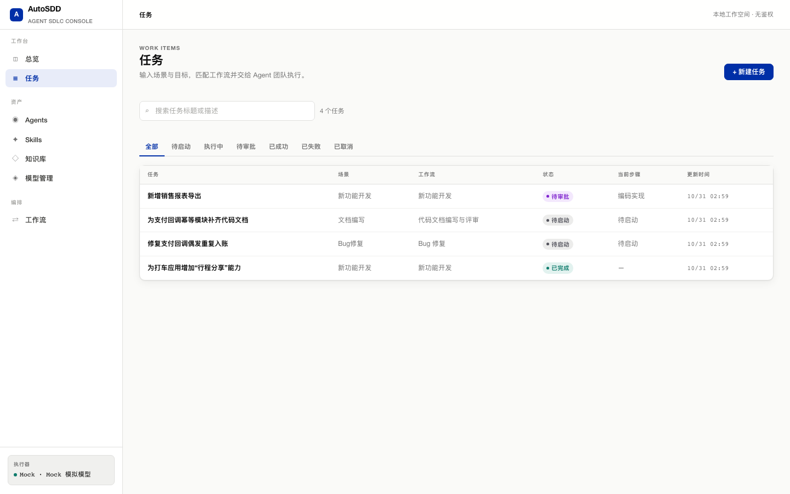

任务列表支持按状态筛选与标题/描述搜索，每 5 秒自动刷新。

### 7.1 新建任务

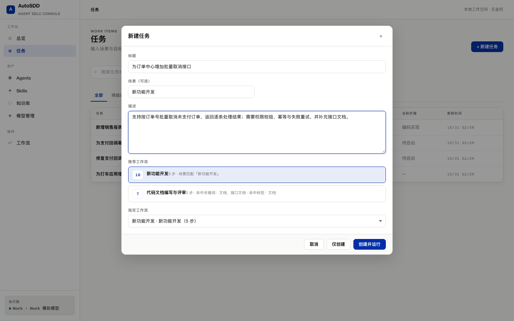

填写标题、场景与描述后，系统按「场景精确 +10、关键词每个 +3、标签每个 +1」打分，展示 top 3 推荐及命中原因。可以选择推荐项，也可以从下拉框手动指定工作流。

点击「创建并运行」后进入任务详情。

### 7.2 实时执行与人工审批

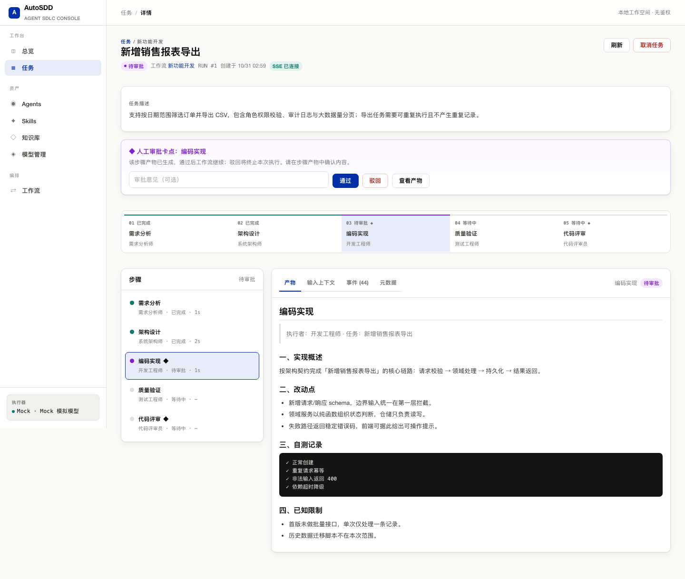

任务详情通过 SSE 实时展示步骤流转与流式输出：

- 顶部显示状态、工作流、run 编号与 SSE 连接状态；
- 步骤条展示每一步的完成/进行中/待审批状态；
- 命中人工卡点时出现审批横幅，可填写意见后「通过」或「驳回」，也可先「查看产物」；
- 「步骤」面板可切换查看每一步的产物、输入上下文、事件与元数据。

### 7.3 完成态

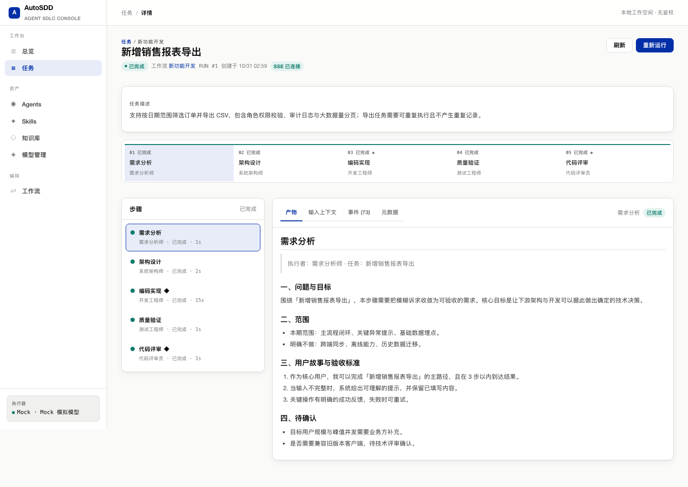

审批通过后继续执行，全部步骤完成即 `SUCCEEDED`。终态任务可以「重新运行」：生成新的 `run_number`，旧 run 与产物完整保留。

### 7.4 上下文与事件

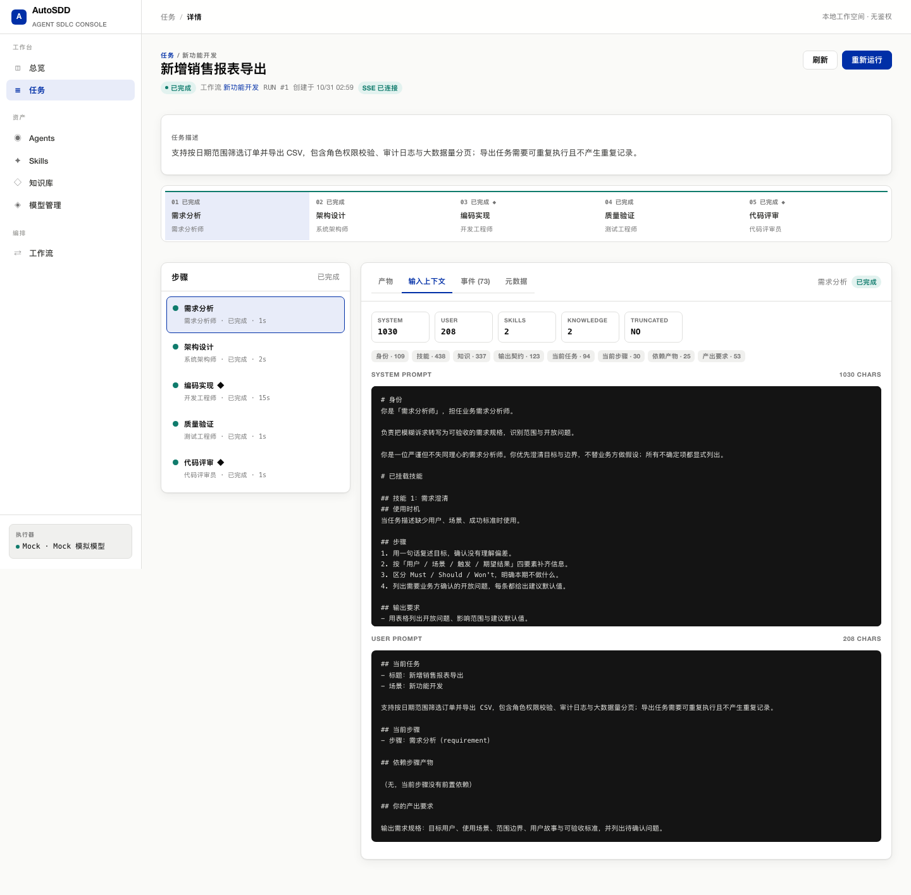

「输入上下文」展示该步骤实际使用的 System/User Prompt 与统计信息；「事件」展示持久化的运行事件，可用于排查状态流转与审批记录。

### 7.5 取消与重跑

- 运行中或待审批的任务可「取消任务」，未完成步骤标记为取消，SSE 推送终态；
- 终态任务可「重新运行」，创建新 run 并重新冻结工作流、Agent、技能与知识快照；
- 服务重启时，进行中的 run 会标记失败（`SERVER_RESTARTED`），等待审批的 run 保留，可继续审批。

---

## 8. 用「代码文档编写与评审」工作流写文档

这条工作流独立于开发流水线，**以任务描述中提供的代码为唯一事实来源**：

1. 在「工作流」中确认「代码文档编写与评审」已启用；
2. 新建任务，标题例如「为支付回调幂等模块补齐代码文档」；
3. 在描述中粘贴代码、接口路径、请求字段、错误码与配置项；
4. 选择该工作流并运行；
5. 「文档编写」（文档专家）产出文档草稿，无法从代码确认的内容会标注「待确认」；
6. 「文档评审」（系统架构师）逐项对照代码与文档，给出通过/修改结论；
7. 在任务详情中查看两步产物与评审意见。

> 文档步骤没有前置依赖，不会自动读取开发流水线的需求或架构产物；需要哪些信息，就把它显式写进任务描述。

---

## 9. 失败演示与排查

- **演示失败**：在任务描述或步骤指令中加入 `[fail]`，或设置 `MOCK_FAIL_STEP=编码实现`。
- **模型未配置**：Anthropic 模型缺少 Key 时，步骤以 `LLM_NOT_CONFIGURED` 失败。
- **空产物**：若模型返回 `stop_reason=max_tokens` / `finish_reason=length` 且没有正文，错误会提示调大 Max Tokens；到「模型管理」将该模型的 Max Tokens 调大（如 16384）后重试。
- **任务冲突**：同一任务已有运行中的 run 时，启动会返回 `RUN_IN_PROGRESS`。
- **删除被引用对象**：删除仍被工作流或 Agent 引用的模型/技能/知识会返回 409，并给出占用信息。

---

## 10. 数据与安全边界

- 默认只监听 `127.0.0.1`，**无鉴权、单工作空间**，请勿直接暴露到公网。
- 数据库默认 `apps/server/data/autosdd.db`；升级或重建前建议备份。
- 模型 Key 可保存在本地 SQLite（明文，仅限本机演示）；接口只返回来源，日志与错误信息不包含 Key。生产环境应接入密钥管理。
- Markdown 渲染不启用原始 HTML，避免 XSS。
- 当前执行为进程内文本生成，不执行代码、不访问文件系统；远程沙箱执行仍是设计草案，见 [远程沙箱设计](../design/11-sandbox.md)。

---

## 11. 维护截图

截图脚本使用独立演示库 `apps/server/data/shots.db` 与端口 `4102`，不会修改开发库：

```bash
# 终端 1：启动临时演示服务
PORT=4102 DATABASE_PATH=./data/shots.db pnpm --filter @autosdd/server start

# 终端 2：生成截图到 docs/guide/images/
pnpm --filter @autosdd/e2e exec node scripts/screenshots.mjs

# 完成后停止临时服务，删除 shots.db
```

脚本会创建一条「新增销售报表导出」任务，演示自动匹配、两次人工审批与完成态，再依次截取各页面。若 UI 结构调整，请同步更新选择器。
